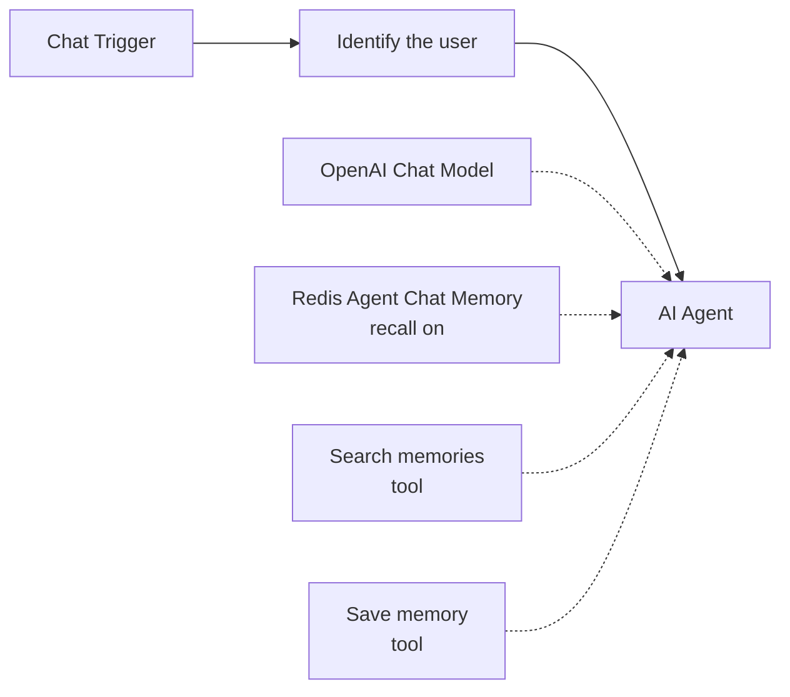
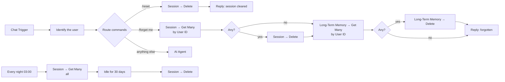
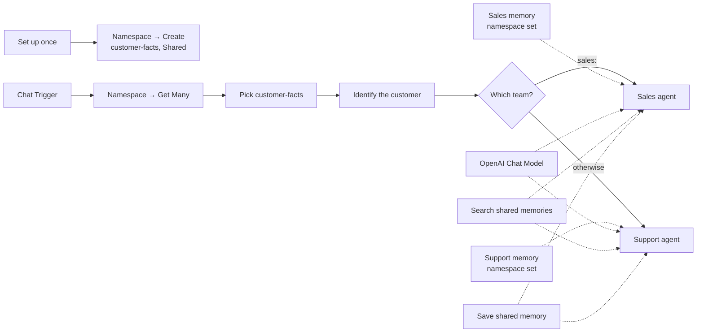
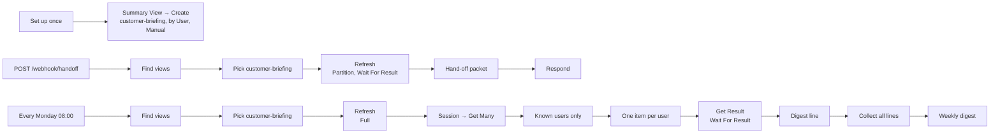
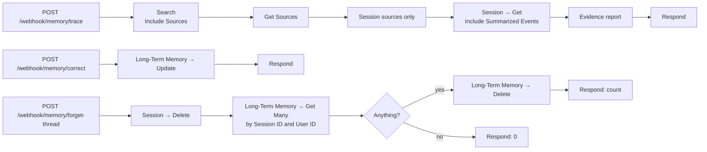
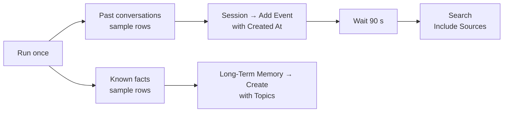

# Example Workflows

Six workflows in [`examples/`](https://github.com/redis/n8n-nodes-agent-memory/tree/main/examples), ready to import. Each was built for a gap that n8n users ask about most, as measured in a survey of the n8n forum, GitHub issues and 1,197 memory templates in November 2026: 86% of memory templates use a sliding window only, long-term memory is hand-built from Google Sheets and Postgres with a "Save Memory" tool the model often never calls, and the most-viewed threads ask for session resets, memory that several agents share without leaking between customers, a way to trace and correct what was learned, hand-off notes and digests, and a way to import history.

## Importing a workflow

1. In n8n, open **Workflows → Create** and choose **Import from URL…** or **Import from File…** from the workflow menu (the `⋯` at the top right of the editor).
2. Use the file's raw URL, `https://raw.githubusercontent.com/redis/n8n-nodes-agent-memory/main/examples/<name>.json`, or download the file and pick it.
3. Open every **Redis** node and select your **Redis Agent Memory API** credential; where an agent is involved, select an **OpenAI** credential on the chat model node.
4. Read the sticky note in the workflow. It holds the steps to try.

The examples use a demo User ID (`demo-user` in a Set node, a webhook body, or sample rows). In your workflow, take it from the authenticated trigger: a Telegram or Slack sender ID, a JWT claim, the n8n user. Never from the message body.

| Workflow | Gap it closes | Node features |
|---|---|---|
| [Agent with long-term memory](#agent-with-long-term-memory) | Facts that outlive the conversation, without a hand-built memory store | Chat memory with recall, Search and Create as tools |
| [Session lifecycle](#session-lifecycle) | `/reset`, "forget me", expire idle sessions | Session → Get Many and Delete, Long-Term Memory → Get Many and Delete |
| [Shared memory across agents](#shared-memory-across-agents) | Two agents on one customer, no bleed between customers | Namespace → Create, the chat memory's Namespace ID option, namespace-scoped tools |
| [Hand-off packet and weekly digest](#hand-off-packet-and-weekly-digest) | Human-readable summaries on demand | Summary View → Create, Refresh and Get Result |
| [Trace, correct and forget](#trace-correct-and-forget) | Audit, corrections, poisoning triage | Search with Include Sources, Get Sources, Session → Get, Update, delete by Session ID |
| [Backfill history](#backfill-history) | Import a year of conversations and known facts | Session → Add Event with Created At, Long-Term Memory → Create with topics |

---

## Agent with long-term memory

**File:** [`agent-with-long-term-memory.json`](https://github.com/redis/n8n-nodes-agent-memory/blob/main/examples/agent-with-long-term-memory.json)

### The gap

The top long-term-memory template on n8n.io and the most-watched tutorials all build the same thing by hand: extract facts about the user from each conversation and recall them on the next one, with a spreadsheet or a database as the store and 20 to 100 extra nodes. This workflow is that pattern with the store, the extraction and the recall on the server.

### What it does



- **Identify the user** (Set) pins `userId` to `demo-user` and passes the chat fields through.
- **Redis Agent Chat Memory** stores each turn in the session and, with **Recall Long-Term Memories** on, searches the user's memories with the current message on every turn and gives the hits to the model.
- **Search memories** is a **Redis Agent Memory Tool** set to Long-Term Memory → Search with the **User ID** pinned to the Set node's value and the **Query** left to the model. The agent uses it when a question depends on history.
- **Save memory** is the same node set to Long-Term Memory → Create, **Text** left to the model. The agent uses it to remember a fact at once, without waiting for extraction.
- The system message tells the model when to use each tool.

### Try it

1. Say: *I'm vegetarian and I live in Sofia.*
2. Start a **new** chat, which is a new session, and ask: *What should I cook tonight?*

The answer uses what you said before: the agent saved it with *Save memory*, the server also extracted it on its own, and the memory node recalled it for the new turn.

### Make it yours

Replace the Set node's constant with an expression over the trigger. Keep **User ID** pinned on both tools. If you only want recall and no tools, delete the two tool nodes; if you want the agent in full control, turn recall off and keep them.

---

## Session lifecycle

**File:** [`session-lifecycle.json`](https://github.com/redis/n8n-nodes-agent-memory/blob/main/examples/session-lifecycle.json)

### The gap

"How do I clear a session key?", "reset memory", "delete all memories": the three most-viewed memory threads on the n8n forum (6,900, 5,735 and 4,774 views) are about the lifecycle of a conversation, and the built-in memory nodes offer nothing beyond letting the session expire. This workflow gives a chat bot `/reset` and `/forget me`, and a nightly job that expires idle sessions.

### What it does



- **Route commands** (Switch) compares the trimmed, lower-cased message with `/reset` and `/forget me`; everything else goes to the agent.
- `/reset`: **Delete this session** removes the current session with its events and summary. Long-term facts stay, and the reply says so.
- `/forget me`: **List my sessions** (Session → Get Many, **User ID** filter, Return All) and **Delete session** for each; then **List my memories** (Long-Term Memory → Get Many, **User ID** filter, Return All, *Execute Once*) and **Delete memory** for each. The two **Any …?** IF nodes handle a user with nothing to delete: the Get Many nodes have *Always Output Data* on, so an empty list still produces one (empty) item and the flow reaches the reply.
- The agent branch is the Quick Start wiring with recall on.
- **Every night at 03:00** (Schedule Trigger) → **List all sessions** (Session → Get Many without filters, Return All) → **Idle for 30 days** (Filter on `updatedAt`, falling back to `createdAt`) → **Delete idle session**.

### Try it

1. Chat: *I'm Ana and I prefer short answers.*
2. Send `/reset`, then ask *What do you know about me?* The fact survives the reset.
3. Send `/forget me`, then ask again. Nothing is left.

### Make it yours

Change the 30 days in the Filter node, or filter by `ownerId` to expire one tenant's sessions. For a Telegram or Slack bot, the Switch works on the message text the same way. If sessions are shared (group chats), turn `/forget me` into an admin-only command: it deletes by User ID, and in a shared session that is every participant's memories.

---

## Shared memory across agents

**File:** [`shared-memory-across-agents.json`](https://github.com/redis/n8n-nodes-agent-memory/blob/main/examples/shared-memory-across-agents.json)

### The gap

Multi-channel and multi-agent builds (a sales bot and a support bot on the same customer, a clinic on WhatsApp and Telegram) are among the most-discussed memory problems in the forum: either each agent forgets what the other learned, or one customer's facts leak into another's chat, and the templates that solve it run to 58–84 nodes. Here both agents write to and recall from one **shared namespace** while the **User ID** keeps customers apart inside it. Each agent keeps its own session, so conversation history does not mix.

### What it does



- **Set up once** (Manual Trigger) → **Create the shared namespace**: Namespace → Create, name `customer-facts`, scope *Shared*. Run it once.
- On each chat message, **Find namespaces** and **Pick customer-facts** look the namespace up by name, and **Identify the customer** (Set) carries `userId`, `namespaceId`, `sessionId` and `chatInput` forward. The lookup is there so the example runs without pasting IDs; see below.
- **Which team?** (Switch) sends messages that start with `sales:` to the **Sales agent** and everything else to the **Support agent**. Each agent strips the prefix from the prompt.
- **Sales memory** and **Support memory** are two chat memory nodes with different **Session ID** prefixes (`sales-…`, `support-…`) and the same **Namespace ID** option, so extracted facts from both land in `customer-facts` and recall searches it.
- **Search shared memories** and **Save shared memory** are tools attached to both agents, with the **User ID** pinned and the namespace set under Options (Search) and Additional Fields (Create).

### Try it

1. Run **Set up once**.
2. Chat: *sales: We are a team of 12 and our budget is 500 a month.*
3. New chat: *support: Which plan fits us?* The support agent knows the team size and budget it was never told.
4. Change `userId` in **Identify the customer** to `other-customer` and ask again: nothing is known.

### Make it yours

In production, store the namespace ID once (a Set node, a workflow variable) and delete the two lookup nodes; one list request per turn is wasteful. Give each channel its own trigger and keep the Switch, or drop the Switch and run one agent per workflow with the same namespace. A **Personal** namespace per customer is the alternative when teams must not share a pool at all; **Long-Term Memory → Move** promotes a memory from one namespace to another.

---

## Hand-off packet and weekly digest

**File:** [`handoff-packet-and-weekly-digest.json`](https://github.com/redis/n8n-nodes-agent-memory/blob/main/examples/handoff-packet-and-weekly-digest.json)

### The gap

The best bot-to-human hand-off template on n8n.io (17,900 views, 39 nodes) has the human type the summary of what the bot learned, and "what did the agent learn this week" digests are built from dozens of nodes. A [summary view](guide/summary-views.md) is a standing summary the server keeps per user, so both become a few nodes.

### What it does



- **Set up once** → **Create the briefing view**: Summary View → Create, name `customer-briefing`, **Group By** *User*, **Output Format** *Text*, **Refresh Mode** *Manual*, with instructions for a briefing under 150 words for a human agent taking over.
- **Hand-off packet.** `POST /webhook/handoff` with `{ "userId": "demo-user" }`. **Find views** and **Pick customer-briefing** look the view up by name; **Refresh this customer's briefing** runs a *Partition* refresh for the **Group** `ownerId` from the request with **Wait For Result** on (up to 90 seconds); **Hand-off packet** (Set) shapes `userId`, `briefing`, `status`, `memoriesSummarized`, `computedAt`; **Respond with the packet** returns it, ready for a Zendesk or HubSpot note.
- **Weekly digest.** **Every Monday at 08:00** → look the view up → **Refresh every briefing** (*Full*) → **List sessions** (Session → Get Many, Return All) → **Known users only** (Filter: has `ownerId`) → **One item per user** (Remove Duplicates on `ownerId`) → **Read the user's briefing** (Get Result with **Wait For Result**, up to 120 seconds, for each user) → **Digest line** (Set: user and text, or "(nothing learned yet)" for an `EMPTY` result) → **Collect all lines** (Aggregate) → **Weekly digest** (Set: one Markdown document). Connect Slack or Gmail after it.

### Try it

1. Run **Set up once**.
2. Chat with any agent example in this folder as `demo-user`, then call the hand-off webhook:

    ```bash
    curl -X POST https://your-n8n/webhook/handoff \
      -H 'Content-Type: application/json' \
      -d '{"userId": "demo-user"}'
    ```

### Make it yours

Summary views must be enabled on the store. In production the **View** field offers the store's views in a list, so pick the view there and drop the lookup nodes. Switch the view to **Continuous** refresh if the briefing must be fresh without a Refresh step; it costs a model call per change. For a structured hand-off (fields for a CRM), create a second view with **Output Format** *Structured* and a schema. To give the agent itself the briefing on every turn, set the chat memory node's **Summary View ID** option to the view's ID.

---

## Trace, correct and forget

**File:** [`trace-and-correct-a-memory.json`](https://github.com/redis/n8n-nodes-agent-memory/blob/main/examples/trace-and-correct-a-memory.json)

### The gap

Corrections ("I moved from Berlin to Madrid"), audit ("which conversation produced this?") and memory poisoning (a feature request on the n8n forum, and the core failure mode named by two 2026 benchmarks) all need to know where a memory came from. No other n8n memory node shows it; Mem0 carries three open requests for exactly this. Every memory here carries its [sources](guide/provenance.md): the session and the exact events it was extracted from.

### What it does

Three HTTP endpoints an operator or an admin workflow can call.



- **Trace.** `{ "userId": "demo-user", "query": "where does the user live" }`. **Search with sources** finds up to three memories with **Include Sources** on; **Get Sources** lists each memory's sources; **Session sources only** keeps the `SESSION` kind; **Read the session** gets the session with **Include Summarized Events** on, so evidence is found even after the session was summarized; **Evidence report** (Set) pairs each memory with the events whose IDs are in the source's `eventIds`, as `role (time): text` lines; the response lists every memory with its evidence.
- **Correct.** `{ "memoryId": "…", "text": "The user lives in Madrid." }`. **Rewrite the memory** is Long-Term Memory → Update with the new **Text**; the memory keeps its ID and sources.
- **Forget a thread.** `{ "userId": "demo-user", "sessionId": "…" }`. **Delete the session**, then **Memories extracted from it** (Get Many with the **Session ID** and **User ID** filters, Return All, *Always Output Data*), **Anything to delete?** (IF) and **Delete memory** for each; the response reports `memoriesDeleted`.

### Try it

Seed memories first by chatting with another example as `demo-user`; extraction takes up to a minute or two. Then:

```bash
curl -X POST https://your-n8n/webhook/memory/trace \
  -H 'Content-Type: application/json' \
  -d '{"userId": "demo-user", "query": "where does the user live"}'
```

Take a `memoryId` and a `sessionId` from the report for the other two endpoints.

### Make it yours

Put the webhooks behind header or JWT authentication: they read and delete user data. For a review queue of facts from an untrusted channel, run the trace on **Get Many** with the **Session ID** filter instead of Search. Document sources (`kind: DOCUMENT`) appear once a store ingests documents; the Filter node leaves them out of the session trace.

---

## Backfill history

**File:** [`backfill-history.json`](https://github.com/redis/n8n-nodes-agent-memory/blob/main/examples/backfill-history.json)

### The gap

"How do I import a year of chat history?" is a recurring forum question (3,303 and 2,268 views on the top threads), and a new deployment that knows nothing about returning customers is a poor first impression. Two import paths, one node each.

### What it does



- **Past conversations (sample rows)** (Code) yields six rows of two old conversations: `sessionId`, `userId`, `role`, `text`, `createdAt`.
- **Replay into sessions** is Session → Add Event per row, with **Created At** under Additional Fields set from the row, so the events keep their original timestamps. The server summarizes the sessions and extracts long-term facts from them, exactly as for a live chat.
- **Known facts (sample rows)** (Code) yields three CRM-style facts with `topics`.
- **Write facts as memories** is Long-Term Memory → Create per row, with **Topics** under Additional Fields. No extraction wait: the facts are searchable at once.
- **Wait for extraction** gives the server 90 seconds, then **What is remembered now?** searches the user's memories with **Include Sources** on: the imported facts (no sources) and the extracted ones (each pointing at the imported session it came from).

### Try it

Run the workflow. Then chat with any agent example as `demo-user`: it knows Maria's bakery, the vegan menu and the Monday closing.

### Make it yours

Replace the two Code nodes with Google Sheets, Postgres, a CSV through *Extract From File*, or your CRM, and keep the column names. Add **Namespace ID** under Additional Fields on both Redis nodes to import into a namespace. Role values are `USER`, `ASSISTANT` and `SYSTEM`. Each row is one request; for very large imports, run the workflow in batches with *Loop Over Items*.
