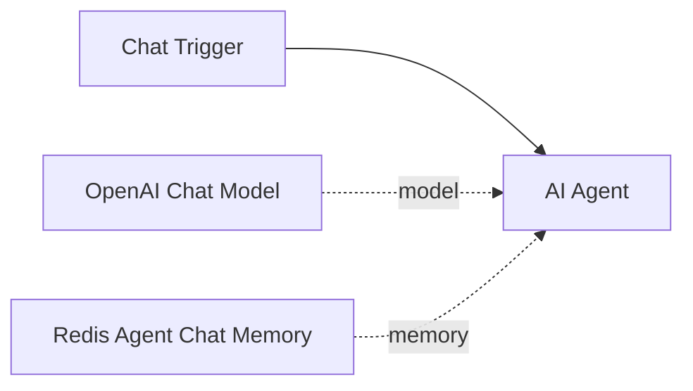

# Quick Start

Give an AI Agent memory that outlives the conversation, in five steps.

## 1. Build the workflow

1. Add a **Chat Trigger** and an **AI Agent** node, and connect a chat model (for example OpenAI).
2. Attach **Redis Agent Chat Memory** to the Agent's **Memory** input and select your Redis Agent Memory credential.
3. Set **User ID** to a stable identifier for the end user. Take it from the authenticated trigger (a JWT claim, a Telegram or Slack sender ID), not from the message body: the User ID is what keeps one user's memories away from another.
4. Leave **Session ID** at its default, `{{ $json.sessionId }}`, which the Chat Trigger provides.
5. Turn on **Recall Long-Term Memories**.

## 2. Chat

Say something worth remembering:

> I'm vegetarian and I live in Sofia.

Recent turns are replayed to the model on each message. Older turns are folded into a server-side summary, and the server extracts lasting facts from the conversation into long-term memory, asynchronously.

## 3. Start a new conversation

Open a new chat, which is a new session, and ask:

> What should I cook tonight?

With **Recall Long-Term Memories** on, the memory node searches the user's long-term memories with the current message and gives the hits to the model before the conversation. The answer uses what you said in the first session.

!!! tip "Extraction takes a moment"
    Facts said in this turn may not be searchable until the next one; on the hosted store extraction has taken from 17 seconds to a minute or more. If the second chat does not know yet, wait and ask again.

## 4. Let the agent decide

Recall on every turn is the simplest wiring. For an agent that looks things up on purpose and saves facts right away, attach **Redis Agent Memory Tool** nodes to the Agent's **Tool** input:

- *Search memories*: **Long-Term Memory → Search**, **User ID** fixed to the same expression as the memory node, **Query** left to the model.
- *Save memory*: **Long-Term Memory → Create**, **User ID** fixed, **Text** left to the model.

Both can be combined with recall. Never let the model fill **User ID**.

## 5. Import the finished example

[`examples/agent-with-long-term-memory.json`](https://github.com/redis/n8n-nodes-agent-memory/blob/main/examples/agent-with-long-term-memory.json) is this workflow, ready to import: select your credentials and chat. The [Examples](../examples.md) page walks through it and five more.

## Where to go next

- [Users, Sessions and Namespaces](../guide/data-model.md) explains the identifiers you just set.
- [Chat Memory](../guide/chat-memory.md) covers the context window, the summary and the other options.
- [Action Node and Tools](../guide/action-node.md) lists what a workflow can do with memories, sessions and namespaces.
