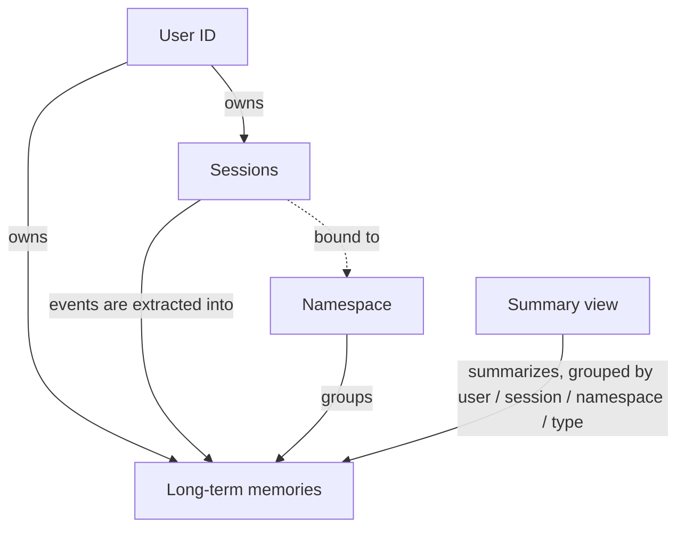

# Users, Sessions and Namespaces

Three identifiers decide who sees what. Get them right and the rest of the node is plumbing.

## User ID

Every long-term memory has an owner, and every search is scoped to one owner. The **User ID** parameter (`ownerId` in a workflow's JSON, on both nodes) is that owner.

- On the chat memory node, the User ID is the user the conversation belongs to. Facts the server extracts from it are owned by this user.
- On **Search**, only this user's memories are searched. On **Create**, the memory belongs to this user.
- On tools, set it yourself from the workflow and never let the model fill it. A model-chosen User ID lets one user read another's memories.

Take the User ID from the authenticated trigger: a Telegram or Slack sender ID, a JWT claim on a Webhook, the n8n user on a Chat Trigger with authentication. Never from the request body.

## Sessions

A session is one conversation: an ordered list of events (user, assistant and system messages) plus a server-maintained summary of the older ones. The chat memory node appends each user and assistant message as an event and reads the recent events back for the model. Tool calls and tool results are not stored.

**Who may read a session.** Anyone who sends a session ID can read and extend that session; the node cannot tell one client from another. Authentication belongs to the trigger, and the workflow should take the Session ID from the authenticated context or derive it from the user. The server records the first writer as the session's owner but accepts events from any user after that. Turn on **Verify Session Owner** on the chat memory node when every session belongs to exactly one user: the node then fails instead of mixing two users' turns. Leave it off for shared sessions, such as group chats.

**Lifecycle.** A session has no expiry of its own. **Session → Delete** removes it with its events and summary; **Session → Delete Event** removes one message and keeps the summary; **Session → Get Many** lists sessions, optionally by owner, with `createdAt` and `updatedAt` for idle clean-up. Deleting a session does not delete the long-term memories extracted from it; those are found with **Long-Term Memory → Get Many** and the **Session ID** filter. The [session lifecycle example](../examples.md#session-lifecycle) wires `/reset`, `/forget me` and a nightly clean-up.

## Namespaces

A namespace groups long-term memories. Without one, a user's memories are simply the user's. With one, several agents or channels can share the facts they learn about a customer while the User ID still keeps customers apart.

- **Namespace → Create** takes a **Name** and a **Scope**: *Shared* (any user's memories may be placed there) or *Personal* (belongs to one user, set under Additional Fields). A **Parent ID** nests the namespace under another; the child inherits the parent's scope and user.
- The chat memory node's **Namespace ID** option binds the session to a namespace: extracted memories land there, and recall searches only it.
- **Search**, **Get Many** and **Create** take a **Namespace ID** option or field; **Long-Term Memory → Move** moves one memory to another namespace, chosen from the store's list.
- **Namespace → Update** renames or archives; the API cannot make an archived namespace active again.

The [shared memory example](../examples.md#shared-memory-across-agents) puts a sales agent and a support agent on one namespace.

## How they fit together

A long-term memory records its `ownerId`, `sessionId` (when extracted from a session), `namespaceId` (when placed in one), `memoryType`, `topics` and `createdAt`, and carries its [sources](provenance.md).
