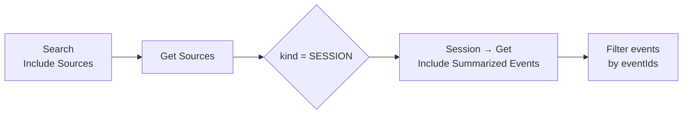

# Memory Sources

Every long-term memory the server extracts can say where it came from: the session and the events, or the document revision, that produced it. This answers "why do you believe that?" for an agent and "which conversation produced this wrong fact?" for an operator, and it makes "forget everything from this thread" a two-step workflow. Corrections, audit and memory poisoning are rising concerns in the n8n community and in other memory vendors' issue trackers; no other n8n memory node exposes provenance.

## Include Sources

**Search**, **Get** and **Get Many** have an **Include Sources** switch (shown when Simplify is on). Each memory then carries `sources`, an array of:

| Field | Meaning |
|---|---|
| `sourceId` | ID of the source link. |
| `kind` | `SESSION` or `DOCUMENT`. |
| `sessionId` | For a session source, the session the memory was extracted from. |
| `documentId` | For a document source, the ingested document. |
| `eventIds` | For a session source, the events that produced the memory. |

It costs no extra request: the data is already in the response. This is the cheapest way to let a tool-using agent cite where a memory came from: "you told the support bot this on 12 May".

## Get Sources

**Long-Term Memory → Get Sources** lists the sources of one **Memory ID**, one item per source, with more detail: `revision` for documents, `eventIds` across every evidence entry, `evidenceCount` (the number of evidence entries, not of events) and `capturedAt` (when the first evidence entry was recorded). With Simplify off, the raw link includes the evidence arrays and the producer that recorded them (`iris-memory-extraction` for the server's extractor).

A memory created directly with **Create** has no sources: nothing extracted it.

## From a source to the evidence

Combine three operations to show the exact messages behind a memory:

**Session → Get** with **Include Summarized Events** on returns every event, including the older ones the summary already covers, so the evidence is found even after the session was summarized. The [trace example](../examples.md#trace-correct-and-forget) wraps this in a webhook.

## Correct a memory

A wrong or outdated fact ("lives in Berlin" after a move to Madrid) is fixed with **Long-Term Memory → Update** and a new **Text**. The memory keeps its ID and sources. Deleting it instead and letting the next conversation re-extract is also fine; the choice depends on whether the old sources still matter for audit.

## Forget a thread

To remove a conversation and what was learned from it, for example one that came from an untrusted channel:

1. **Session → Delete** the session.
2. **Long-Term Memory → Get Many** with the **Session ID** and **User ID** filters, Return All.
3. **Long-Term Memory → Delete** each result.

Deleting the session alone does not delete the memories extracted from it: they are the user's long-term facts and stay until deleted. The same three steps, with the **User ID** filter alone and **Session → Get Many** by owner, implement "forget me".
